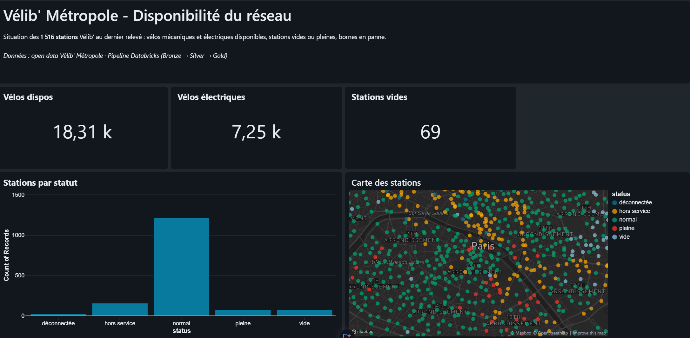
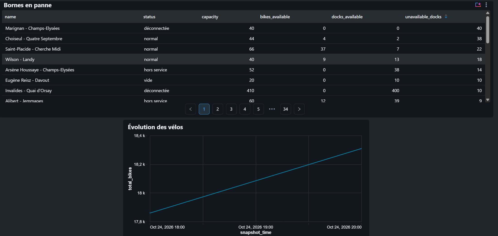
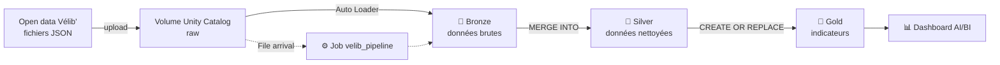
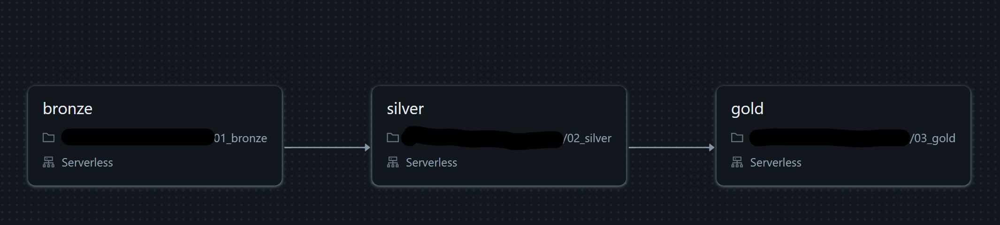
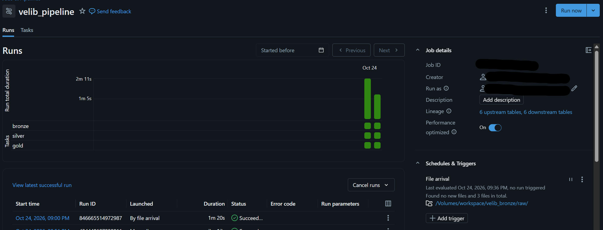
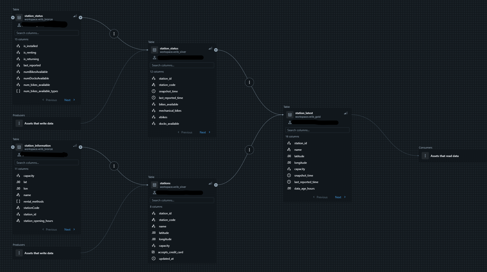

# 🚲 Vélib' Métropole – Pipeline de données sur Databricks

Pipeline de données de bout en bout sur **Databricks (Free Edition)** : ingestion des données open data Vélib', nettoyage, calcul d'indicateurs et dashboard, le tout **automatisé** par un Job déclenché à l'arrivée d'un nouveau fichier.




---

## 🎯 Objectif

Suivre la disponibilité des **~1 500 stations Vélib'** de Paris et sa petite couronne :
- combien de vélos mécaniques et électriques sont disponibles ?
- quelles stations sont vides, pleines, hors service ou déconnectées ?
- quelles stations ont le plus de bornes en panne ?
- comment évolue le nombre de vélos au fil de la journée ?

---

## 🏗️ Architecture

Architecture **médaillon** (Bronze → Silver → Gold) avec **Delta Lake** et **Unity Catalog**.



| Couche | Tables | Rôle |
|---|---|---|
| **Bronze** | `station_status`, `station_information` | Données brutes, une ligne par station, + fichier source et heure de chargement |
| **Silver** | `stations`, `station_status` | Données propres : types corrigés, heure de Paris, vélos mécaniques / électriques séparés, sans doublons |
| **Gold** | `station_latest`, `station_hourly`, `network_summary` | Indicateurs prêts pour le dashboard |

---

## 🛠️ Technologies

- **Databricks Free Edition** (compute serverless)
- **PySpark** et **Spark SQL**
- **Delta Lake** (MERGE, historique, time travel)
- **Unity Catalog** (catalogue, schémas, volumes, lineage)
- **Auto Loader** (ingestion incrémentale)
- **Lakeflow Jobs** (orchestration, déclencheur *File arrival*)
- **AI/BI Dashboards** (visualisation, SQL Warehouse serverless)

---

## 📂 Structure du projet

```
├── notebooks/
│   ├── 00_setup.ipynb      # Création des schémas et du volume
│   ├── 01_bronze.ipynb     # Ingestion avec Auto Loader
│   ├── 02_silver.ipynb     # Nettoyage et MERGE
│   └── 03_gold.ipynb       # Indicateurs pour le dashboard
├── images/
│   ├── dashboard_1.png     # Dashboard : indicateurs clés et carte
│   ├── dashboard_2.png     # Dashboard : bornes en panne et évolution
│   ├── job.png             # Schéma des tâches du Job
│   ├── job_runs.png        # Exécutions du Job (déclenchement par arrivée de fichier)
│   └── lineage.png         # Lineage Unity Catalog
└── README.md
```

---

## 🔄 Détail du pipeline

### 1. Bronze – ingestion incrémentale
- Lecture des fichiers JSON du volume avec **Auto Loader** (`cloudFiles`).
- Seuls les **nouveaux fichiers** sont chargés : le *checkpoint* garde la liste des fichiers déjà traités.
- La liste des stations est « dépliée » (`explode`) : **une ligne par station**.
- Ajout de colonnes techniques : fichier source et heure de chargement.

### 2. Silver – nettoyage
- Conversion des horodatages Unix (UTC) en **heure de Paris**.
- Séparation des vélos **mécaniques** et **électriques** (liste imbriquée remise à plat).
- Retrait des stations non installées.
- Mise à jour avec **`MERGE INTO`** : pas de doublon si on relance.
- **Contrôles qualité** : cohérence vélos = mécaniques + électriques, pas de valeur négative.

### 3. Gold – indicateurs
- **`station_latest`** : dernier état de chaque station, avec un statut (*normal, vide, pleine, hors service, déconnectée*), le taux de remplissage et les bornes indisponibles.
- **`station_hourly`** : moyennes par station, par heure et par type de jour (semaine / week-end).
- **`network_summary`** : totaux du réseau à chaque relevé.

### 4. Orchestration
Un **Job** enchaîne les 3 notebooks (bronze → silver → gold). Il se lance **automatiquement** dès qu'un nouveau fichier arrive dans le volume (*File arrival trigger*).




---

## 🔗 Lineage (Unity Catalog)

Unity Catalog trace automatiquement le chemin des données, du Bronze jusqu'au dashboard :



---

## 🔍 Analyse qualité : un cas concret

Au départ, **164 stations** étaient marquées « hors service » (`is_renting = false`).
Le retard moyen de leur dernier signal était d'environ **1 000 heures**, ce qui laissait penser à des stations déconnectées.

En creusant :
- cette **moyenne était faussée** par quelques valeurs extrêmes (jusqu'à environ 9 ans de retard) ;
- avec une règle « pas de signal depuis plus de 3 h », seules **16 stations** sont réellement **déconnectées** ;
- les **150 autres** communiquent normalement mais sont **bloquées par l'opérateur**.

➡️ Création d'un statut **« déconnectée »**, et exclusion de ces stations des moyennes et des totaux, pour ne pas mélanger des chiffres actuels avec des chiffres périmés.

---

## 🚀 Reproduire le projet

1. Créer un compte **Databricks Free Edition**.
2. Importer les notebooks du dossier `notebooks/`.
3. Lancer `00_setup` (schémas + volume).
4. Télécharger les fichiers open data et les déposer dans le volume `raw` :
   - `station_information.json`
   - `station_status.json` (renommé avec l'heure, ex. `station_status_2026-10-24_1850.json`)
5. Lancer `01_bronze`, `02_silver`, `03_gold` (ou créer le Job).
6. Créer le dashboard à partir des tables Gold.

Source des données : [Vélib' Métropole – open data (GBFS)](https://www.velib-metropole.fr/donnees-open-data-gbfs-du-service-velib-metropole)

---

## ⚠️ Limites

- La Free Edition **bloque l'accès internet** depuis les notebooks : les fichiers sont téléchargés puis déposés manuellement dans le volume.
- Les analyses par heure deviennent intéressantes avec **plusieurs jours de relevés**.

## 🔮 Pistes d'amélioration

- Collecte automatique des fichiers (script planifié).
- Modèle de **machine learning** pour prédire le nombre de vélos dans 1 heure (MLflow, Unity Catalog).
- Pipeline déclaratif **Lakeflow** avec des *expectations* pour la qualité des données.

---

👤 **Shamcya Mohamed Electon** – Data Engineer
